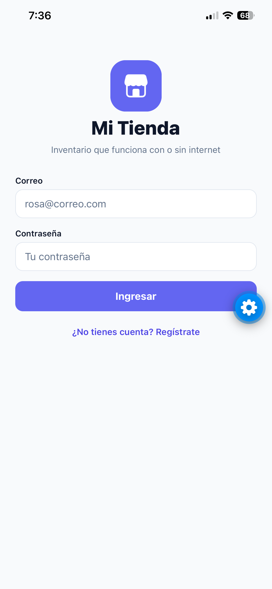
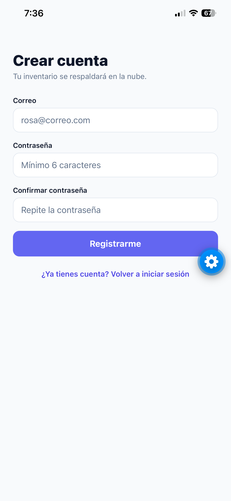
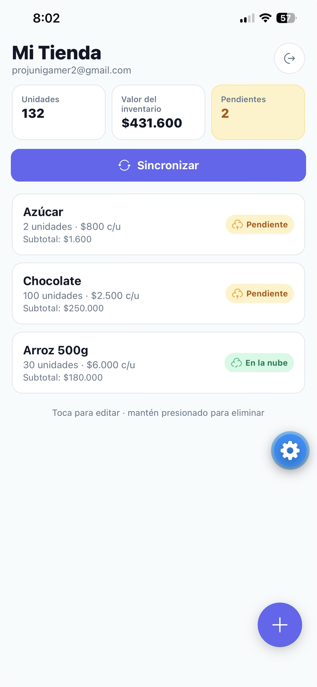
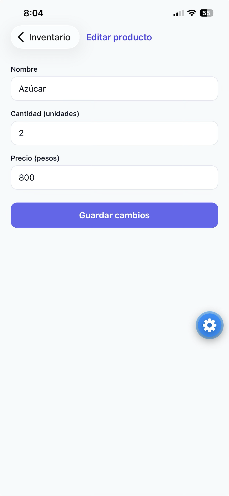
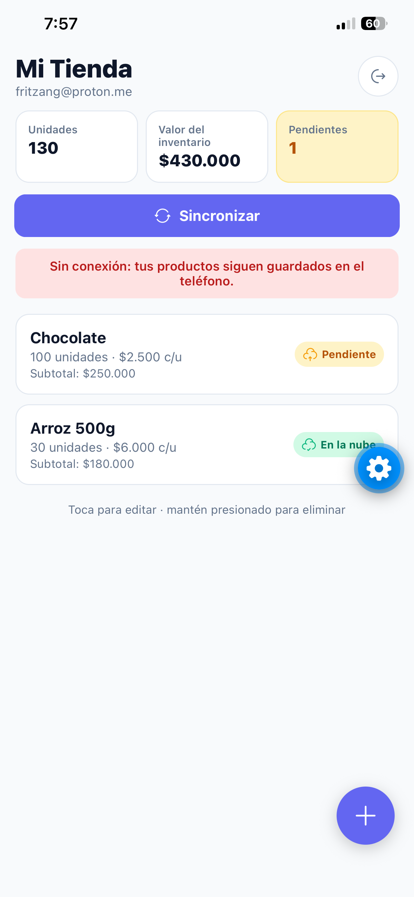
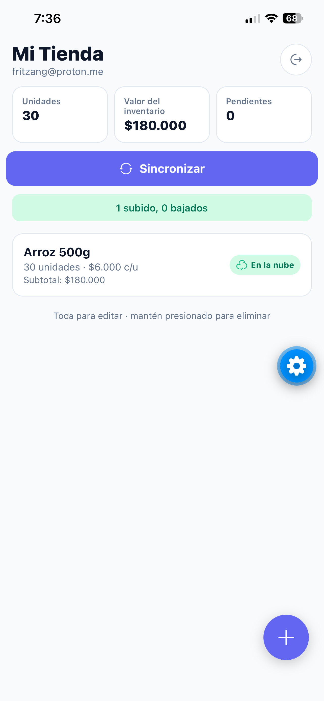
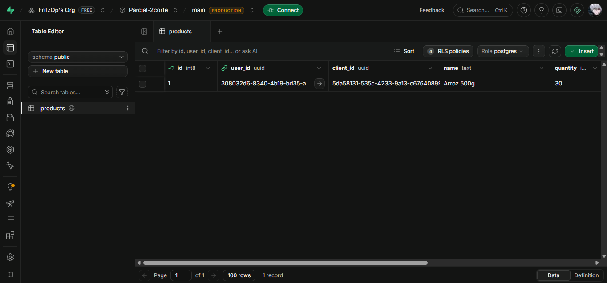

# Mi Tienda — Parcial 2.º corte

App móvil de inventario para una tienda de barrio (Doña Rosa, Riohacha). Funciona **sin internet** con SQLite y respalda en **Supabase** cuando hay conexión.

- **Estudiante:** Edgar Zuñiga
- **Código:** _(escribir aquí tu código estudiantil)_
- **Stack:** Expo SDK 58 · TypeScript · Expo Router · SQLite + Drizzle ORM · Supabase (Auth + Postgres) · expo-secure-store · Reanimated

## Cómo ejecutar

1. Instala dependencias:
   ```bash
   npm install
   ```
2. Crea el archivo `.env` a partir de `.env.example` (solo la **publishable key**, nunca la secret key):
   ```env
   EXPO_PUBLIC_SUPABASE_URL=https://tu-proyecto.supabase.co
   EXPO_PUBLIC_SUPABASE_PUBLISHABLE_KEY=sb_publishable_...
   ```
3. En el **SQL Editor** de Supabase ejecuta [`supabase/products.sql`](supabase/products.sql) (tabla `products` + políticas RLS).
4. En Supabase → Authentication → Providers → Email, **desactiva "Confirm email"**; si no, el registro no inicia sesión.
5. Inicia la app y ábrela con Expo Go:
   ```bash
   npx expo start
   ```

Si cambias `src/db/schema.ts`: `npx drizzle-kit generate` y se aplica solo al abrir la app (`useMigrations`).

## Estructura

```text
src/
├── app/                 # Expo Router
│   ├── _layout.tsx      # migraciones + AuthProvider + Stack.Protected
│   ├── login.tsx        # Inicio de sesión
│   ├── registro.tsx     # Registro con validaciones
│   ├── index.tsx        # Inventario, totales, Sincronizar, Cerrar sesión
│   └── producto.tsx     # Crear / editar (si recibe id)
├── db/
│   ├── schema.ts        # tabla products (sin imports de Expo)
│   ├── client.ts        # expo-sqlite + drizzle
│   └── repositories/products.ts
├── hooks/               # useProducts (useLiveQuery), useSync
├── services/sync.ts     # syncProducts(userId): bajar y luego subir
├── lib/                 # supabase.ts, secureStorage.ts (adaptador por fragmentos)
├── context/AuthContext.tsx
└── components/          # Animated.tsx, ProductItem.tsx, Field.tsx
drizzle/                 # migración generada con drizzle-kit
```

## Cómo funciona

- **SQLite es la fuente de verdad**: la app siempre lee y escribe en local; Supabase solo se usa para autenticar y sincronizar.
- **Pendiente** = `syncedAt` vacío o anterior a `updatedAt`. Cada creación o edición escribe `updatedAt: new Date()`.
- **Sincronizar** (`src/services/sync.ts`): 1) baja los productos de la nube cuyo `client_id` no existe en local y los marca sincronizados; 2) sube los pendientes con `upsert` por `client_id` (sin duplicar) y los marca con `syncedAt = updatedAt` subido.
- **Sesión** guardada en SecureStore con un adaptador que parte el valor en fragmentos (límite ~2 KB); sobrevive al cerrar la app.
- **Rutas protegidas** con `Stack.Protected`: sin sesión solo Login/Registro; con sesión solo Inventario/Formulario.
- **Eliminar**: mantener presionado un producto y confirmar.
- **Animaciones** (traídas de mi proyecto StudyAI): `AnimatedEntrance`, `AnimatedPressable` y `AnimatedPulse` (API `Animated` de React Native), más `react-native-reanimated` para entrada/salida/reacomodo de la lista, e íconos con `reicon-react-native`.

## Capturas

| | |
|---|---|
|  |  |
|  |  |
|  |  |
|  | |

## Qué quedó funcionando y qué no

- ✅ Registro, login y cierre de sesión; sesión persistente en SecureStore; rutas protegidas.
- ✅ CRUD de productos en SQLite con lista reactiva, totales (unidades, valor) y contador de pendientes; funciona en modo avión.
- ✅ Indicador por producto (Pendiente / En la nube) y confirmación al eliminar.
- ✅ Sincronización: sube pendientes sin duplicar, baja los que faltan y muestra el resultado o el error de red.
- ⛔ Fuera de alcance (no implementado): borrado sincronizado, resolución de conflictos, sincronización automática, búsqueda.
